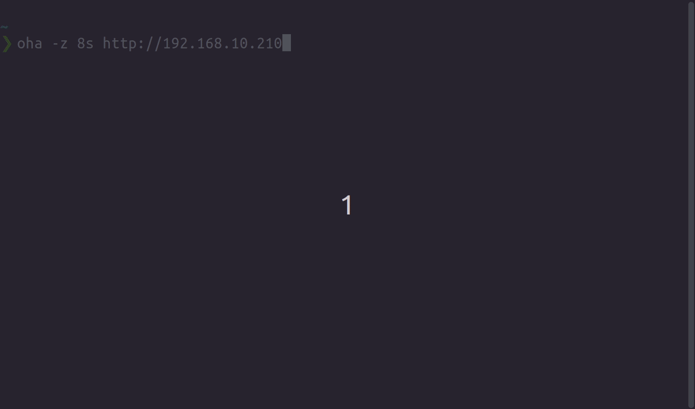

> **语言**：本文档为简体中文翻译，[点此查看英文原版 README.md](README.md)。

# oha (おはよう)

[](https://github.com/hatoo/oha/actions?query=workflow%3ACI)
[](https://crates.io/crates/oha)
[](https://archlinux.org/packages/extra/x86_64/oha/)
[](https://formulae.brew.sh/formula/oha)

[](https://ko-fi.com/hatoo)

oha 是一个小型程序，它向 Web 应用发送一定的负载并以实时 TUI 展示结果，灵感来自 [rakyll/hey](https://github.com/rakyll/hey)。

本程序使用 Rust 编写，由 [tokio](https://github.com/tokio-rs/tokio) 驱动，并由 [ratatui](https://github.com/ratatui-org/ratatui) 打造出精美的 TUI。



# 安装

本程序基于稳定的 Rust 构建，通过 cargo 安装之前还需要先具备 `make` 和 `cmake`。

    cargo install oha

你可以选择改用 [native-tls](https://github.com/sfackler/rust-native-tls) 而非 [rustls](https://github.com/rustls/rustls) 来构建 oha。

    cargo install --no-default-features --features native-tls oha

通过启用 `vsock` 特性可以开启 VSOCK 支持。

    cargo install --features vsock oha

通过启用 `http3` 特性可以开启实验性的 HTTP3 支持。该功能使用由 Hyper 的开发者们开发的 [H3](https://github.com/hyperium/h3) 库。
只要 H3 仍处于实验阶段，它就会保持实验性质。目前它依赖 `rustls` 来处理 TLS。

## 下载预编译二进制

你可以从[发布页面](https://github.com/hatoo/oha/releases)下载各个版本的预编译二进制，也可以从 [Publish workflow](https://github.com/hatoo/oha/actions/workflows/release.yml) 和 [Publish PGO workflow](https://github.com/hatoo/oha/actions/workflows/release-pgo.yml) 下载各个提交对应的构建产物。

## 在 Arch Linux 上

    pacman -S oha

## 在 macOS 上（Homebrew）

    brew install oha

## 在 Windows 上（winget）

    winget install hatoo.oha

## 在 Debian 上（[Azlux 的软件仓库](http://packages.azlux.fr/)）

    echo "deb [signed-by=/usr/share/keyrings/azlux-archive-keyring.gpg] http://packages.azlux.fr/debian/ stable main" | sudo tee /etc/apt/sources.list.d/azlux.list
    sudo wget -O /usr/share/keyrings/azlux-archive-keyring.gpg https://azlux.fr/repo.gpg
    apt update
    apt install oha

## X-CMD（Linux、macOS、Windows WSL/GitBash）

你可以使用 [x-cmd](https://www.x-cmd.com) 安装。

```sh
x env use oha
```

## 容器化

### 官方 Docker 镜像

[ghcr.io/hatoo/oha](https://github.com/hatoo/oha/pkgs/container/oha)

### 在本地构建镜像

你还可以构建包含 oha 的容器镜像

```sh
docker build -t hatoo/oha:latest .
```

然后你就可以直接通过容器使用 oha

```sh
docker run --rm -it --network=host hatoo/oha:latest https://example.com:3000
```

## Profile-Guided Optimization（PGO）

你可以使用以下命令构建启用 PGO 的 `oha`：

```sh
bun run pgo.js
```

生成的二进制将位于 `target/[target-triple]/pgo/oha`。

**注意**：请记住，要运行上述命令，
你需要先安装 `cargo-pgo` cargo 包。

你可以通过 `cargo install cargo-pgo` 来安装它。

# 平台

- Linux - 在 Ubuntu 18.04 gnome-terminal 上测试过
- Windows 10 - 在 Windows Powershell 上测试过
- MacOS - 在 iTerm2 上测试过

# 用法

`-q` 选项的行为与 [rakyll/hey](https://github.com/rakyll/hey) 不同：它设置的是整体的每秒查询数，而不是每个 worker 的每秒查询数。

```sh
Ohayou(おはよう), HTTP load generator, inspired by rakyll/hey with tui animation.

Usage: oha [OPTIONS] <URL>

Arguments:
  <URL>  Target URL or file with multiple URLs.

Options:
  -n <N_REQUESTS>
          Number of requests to run. Accepts plain numbers or suffixes: k = 1,000, m = 1,000,000 (e.g. 10k, 1m). [default: 200]
  -c <N_CONNECTIONS>
          Number of connections to run concurrently. You may should increase limit to number of open files for larger `-c`. [default: 50]
  -p <N_HTTP2_PARALLEL>
          Number of parallel requests to send on HTTP/2. `oha` will run c * p concurrent workers in total. [default: 1]
  -z <DURATION>
          Duration of application to send requests.
          On HTTP/1, When the duration is reached, ongoing requests are aborted and counted as "aborted due to deadline"
          You can change this behavior with `-w` option.
          Currently, on HTTP/2, When the duration is reached, ongoing requests are waited. `-w` option is ignored.
          Examples: -z 10s -z 3m.
  -w, --wait-ongoing-requests-after-deadline
          When the duration is reached, ongoing requests are waited
  -q <QUERY_PER_SECOND>
          Rate limit for all, in queries per second (QPS)
      --burst-delay <BURST_DURATION>
          Introduce delay between a predefined number of requests.
          Note: If qps is specified, burst will be ignored
      --burst-rate <BURST_REQUESTS>
          Rates of requests for burst. Default is 1
          Note: If qps is specified, burst will be ignored
      --rand-regex-url
          Generate URL by rand_regex crate but dot is disabled for each query e.g. http://127.0.0.1/[a-z][a-z][0-9]. Currently dynamic scheme, host and port with keep-alive do not work well. See https://docs.rs/rand_regex/latest/rand_regex/struct.Regex.html for details of syntax.
      --urls-from-file
          Read the URLs to query from a file
      --max-repeat <MAX_REPEAT>
          A parameter for the '--rand-regex-url'. The max_repeat parameter gives the maximum extra repeat counts the x*, x+ and x{n,} operators will become. [default: 4]
      --dump-urls <DUMP_URLS>
          Dump target Urls <DUMP_URLS> times to debug --rand-regex-url
      --latency-correction
          Correct latency to avoid coordinated omission problem. It's ignored if -q is not set.
      --no-tui
          No realtime tui
      --fps <FPS>
          Frame per second for tui. [default: 16]
  -m, --method <METHOD>
          HTTP method [default: GET]
  -H <HEADERS>
          Custom HTTP header. Examples: -H "foo: bar"
      --proxy-header <PROXY_HEADERS>
          Custom Proxy HTTP header. Examples: --proxy-header "foo: bar"
  -t <TIMEOUT>
          Timeout for each request. Default to infinite.
      --connect-timeout <CONNECT_TIMEOUT>
          Timeout for establishing a new connection. Default to 5s. [default: 5s]
  -A <ACCEPT_HEADER>
          HTTP Accept Header.
  -d <BODY_STRING>
          HTTP request body.
  -D <BODY_PATH>
          HTTP request body from file.
  -Z <BODY_PATH_LINES>
          HTTP request body from file line by line.
  -F, --form <FORM>
          Specify HTTP multipart POST data (curl compatible). Examples: -F 'name=value' -F 'file=@path/to/file'
  -T <CONTENT_TYPE>
          Content-Type.
  -a <BASIC_AUTH>
          Basic authentication (username:password), or AWS credentials (access_key:secret_key)
      --aws-session <AWS_SESSION>
          AWS session token
      --aws-sigv4 <AWS_SIGV4>
          AWS SigV4 signing params (format: aws:amz:region:service)
  -x <PROXY>
          HTTP proxy
      --proxy-http-version <PROXY_HTTP_VERSION>
          HTTP version to connect to proxy. Available values 0.9, 1.0, 1.1, 2.
      --proxy-http2
          Use HTTP/2 to connect to proxy. Shorthand for --proxy-http-version=2
      --http-version <HTTP_VERSION>
          HTTP version. Available values 0.9, 1.0, 1.1, 2, 3
      --http2
          Use HTTP/2. Shorthand for --http-version=2
      --host <HOST>
          HTTP Host header
      --disable-compression
          Disable compression.
  -r, --redirect <REDIRECT>
          Limit for number of Redirect. Set 0 for no redirection. Redirection isn't supported for HTTP/2. [default: 0]
      --disable-keepalive
          Disable keep-alive, prevents re-use of TCP connections between different HTTP requests. This isn't supported for HTTP/2.
      --no-pre-lookup
          *Not* perform a DNS lookup at beginning to cache it
      --ipv6
          Lookup only ipv6.
      --ipv4
          Lookup only ipv4.
      --cacert <CACERT>
          (TLS) Use the specified certificate file to verify the peer. Native certificate store is used even if this argument is specified.
      --cert <CERT>
          (TLS) Use the specified client certificate file. --key must be also specified
      --key <KEY>
          (TLS) Use the specified client key file. --cert must be also specified
      --insecure
          Accept invalid certs.
      --connect-to <CONNECT_TO>
          Override DNS resolution and default port numbers with strings like 'example.org:443:localhost:8443'
          Note: if used several times for the same host:port:target_host:target_port, a random choice is made
      --no-color
          Disable the color scheme. [env: NO_COLOR=]
      --unix-socket <UNIX_SOCKET>
          Connect to a unix socket instead of the domain in the URL. Only for non-HTTPS URLs.
      --stats-success-breakdown
          Include a response status code successful or not successful breakdown for the time histogram and distribution statistics
      --db-url <DB_URL>
          Write succeeded requests to sqlite database url E.G test.db
      --debug
          Perform a single request and dump the request and response
  -o, --output <OUTPUT>
          Output file to write the results to. If not specified, results are written to stdout.
      --output-format <OUTPUT_FORMAT>
          Output format [default: text] [possible values: text, json, csv, quiet]
  -u, --time-unit <TIME_UNIT>
          Time unit to be used. If not specified, the time unit is determined automatically. This option affects only text format. [possible values: ns, us, ms, s, m, h]
      --worker-threads <WORKER_THREADS>
          Number of native OS threads used by the async runtime (tokio).
          Takes precedence over the TOKIO_WORKER_THREADS environment variable. When neither is set, the number of physical CPU cores is used.
  -h, --help
          Print help
  -V, --version
          Print version
```

# 性能

当设置了 `--no-tui` 选项且 `-q` 与 `--burst-delay` 均未设置时，`oha` 会使用更快的实现，因为这样可以避免实时收集数据带来的开销。

# 输出

默认情况下，`oha` 会输出一份文本格式的结果摘要。

当设置 `--output-format json` 选项时，`oha` 会输出 JSON 格式的结果摘要。
JSON 输出的结构定义在 [schema.json](./schema.json) 中。

使用 `--output-format csv` 时，每个请求的结果会作为一行逗号分隔的值打印出来。

# 小贴士

## 在更真实的条件下进行压力测试

`oha` 沿用了从 [rakyll/hey](https://github.com/rakyll/hey) 继承来的默认选项，但若想在更真实的条件下进行压力测试，你可能需要修改这些选项。

我建议按照下列选项运行 `oha`。

```sh
oha <-z or -n> -c <number of concurrent connections> -q <query per seconds> --latency-correction --disable-keepalive <target-address>
```

- --disable-keepalive

    在真实场景中，用户并不会用 [Keep-Alive](https://developer.mozilla.org/en-US/docs/Web/HTTP/Headers/Keep-Alive) 请求同一个 URL。你可能希望在不启用 `Keep-Alive` 的情况下运行。
- --latency-correction

    使用 `--latency-correction` 可以避免 `Coordinated Omission Problem`。

## 突发（Burst）功能

你可以将 `--burst-delay` 与 `--burst-rate` 选项配合使用，在指定数量的请求之间引入延迟。

```sh
oha -n 10 --burst-delay 2s --burst-rate 4
```

在这种特定场景下，每 2 秒会处理 4 个请求，6 秒后全部 10 个请求将被处理完毕。
*注：如果你不设置 `--burst-rate` 选项，该数量默认为 1*

## 动态 URL 功能

你可以使用 `--rand-regex-url` 选项为每个连接生成随机 URL。

```sh
oha --rand-regex-url http://127.0.0.1/[a-z][a-z][0-9]
```

每个 URL 都由 [rand_regex](https://github.com/kennytm/rand_regex) crate 生成，但正则中的点号（dot）对每次查询都被禁用，因为它对这个用途没什么用，而且如果 URL 中的点号被解释成正则的点号，会非常不方便。

你还可以设置 `--max-repeat` 选项来限制每个正则的最大重复次数。例如 http://127.0.0.1/[a-z]* 配合 `--max-repeat 4` 将会生成类似 http://127.0.0.1/[a-z]{0,4} 的 URL

目前，动态的 scheme、host 和 port 配合 keep-alive 使用时并不能很好地工作。

## 从文件读取 URL 功能

你可以使用 `--urls-from-file` 从文件中读取目标 URL。该文件的每一行需要包含一个有效的 URL，如下例所示。

```
http://domain.tld/foo/bar
http://domain.tld/assets/vendors-node_modules_highlight_js_lib_index_js-node_modules_tanstack_react-query_build_modern-3fdf40-591fb51c8a6e.js
http://domain.tld/images/test.png
http://domain.tld/foo/bar?q=test
http://domain.tld/foo
```

这样的文件例如可以由访问日志生成，从而在服务器的不同页面之间产生更真实的负载分布。 

使用这种 URL 指定方式时，每个请求都会发往文件中给出的某个随机 URL。

# 贡献

欢迎参与贡献！

以下是一些有待改进的方面。

- 编写测试
- 改进 TUI 设计。
  - 展示更多信息？
- 提升速度
  - 我刚接触 tokio。我觉得查询调度还有可以优化的空间。
